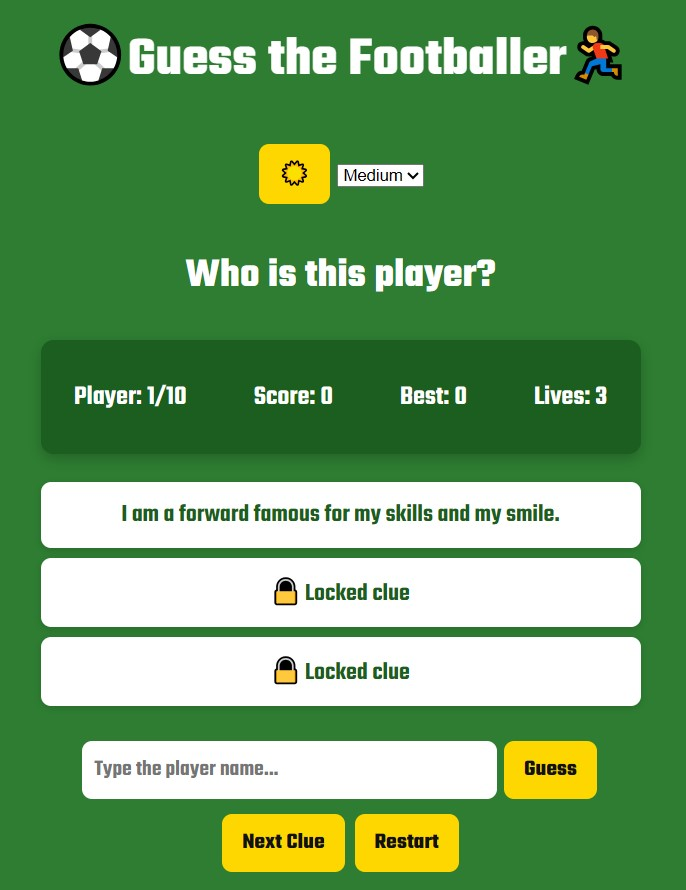
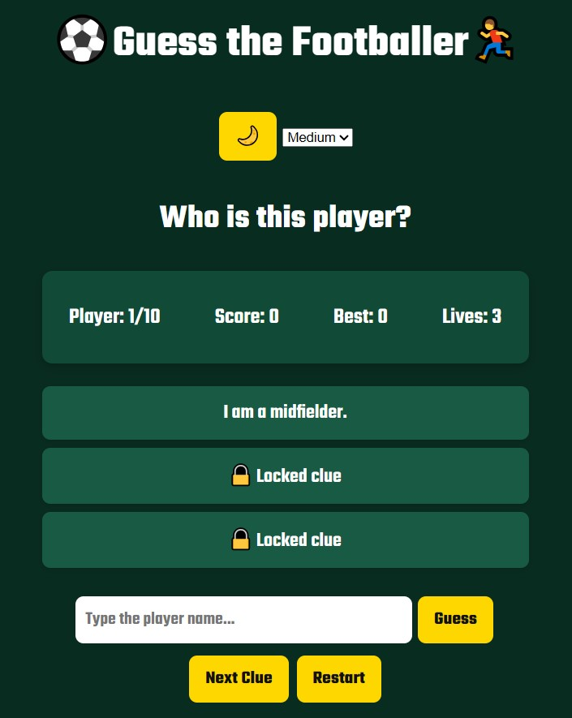

# ⚽ FootyIntel - Guess the Footballer

## Technologies Used

- **HTML5:** Semantic markup and page structure.
- **CSS3:** CSS variables, Flexbox, theme customization, keyframe animations, and Google Fonts (Teko).
- **JavaScript (Vanilla ES6):** DOM manipulation, array shuffling, game state management, and scoring logic.
- **Web Audio API:** Generates sound effects using `AudioContext`.
- **localStorage:** Saves the high score and the chosen theme.
- **Git & GitHub:** Version control and source code hosting.
- **GitHub Pages:** Public deployment of the game.

---

## Description

**FootyIntel** is an interactive web-based trivia game where football fans guess famous players from progressive clues. Every game starts with a shuffled deck of players. Reveal more clues if you are stuck, but each extra clue costs you points!

### Features

- ⚽ **Progressive Clues:** Reveal up to three clues per player.
- 🏆 **High Score:** Your best score is saved with `localStorage`.
- 🌙 **Dark & Light Mode:** Switch themes, and your choice is remembered.
- 🎯 **Difficulty Levels:** Easy (5 lives), Medium (3 lives), and Hard (2 lives), each with its own player pool.
- 🔊 **Sound Effects:** Audio cues for correct guesses, mistakes, winning, and game over.
- 🎬 **Animations:** Shake effect for wrong answers and pop effect for correct ones.

### How to Play

1. Choose a difficulty level: **Easy**, **Medium**, or **Hard**.
2. Read the first clue.
3. Type the footballer's name (the full name or the last part of it, e.g. "Van Dijk") and click **Guess** or press `Enter`.
4. Stuck? Click **Next Clue** to reveal another hint.
5. Guess every player in the deck without running out of lives to win.

### Game Rules & Scoring

| Rule | Details |
|---|---|
| **Score** | Points per correct answer = `4 - number of clues used`. |
| **Easy** | 5 lives, famous football legends. |
| **Medium** | 3 lives, well-known current and classic players. |
| **Hard** | 2 lives, challenging football icons. |
| **Win** | Guess every player in the deck. |
| **Lose** | Lives reach zero. |

---

## User Stories

As a player:

- I want to start a new game with randomly shuffled players so that every playthrough feels fresh.
- I want to unlock clues one by one so that I can get help while sacrificing some points.
- I want to enter the full name or the last part of a name so that I can answer naturally.
- I want visual and audio feedback for correct and incorrect answers so that the game feels engaging.
- I want to choose a difficulty level so that it matches my football knowledge.
- I want my highest score saved across sessions so that I can try to beat my record.
- I want to switch between Light Mode and Dark Mode based on my preference.

---

## Screenshots

| Light Mode | Dark Mode |
| :---: | :---: |
|  |  |

---

## Future Enhancements

- Add more football players and clues.
- Introduce a timer-based challenge mode.
- Add player images and club badges.
- Include a leaderboard with multiple players.
- Add a pause/resume feature and a mute button.

---

## Credits

- **Author:** Sayed Jaafar Ali Khalifat - [@SjaafarAliKh](https://github.com/SjaafarAliKh)
- **Font:** [Teko](https://fonts.google.com/specimen/Teko) from Google Fonts.
- **Hosting:** GitHub Pages.
- Built during the General Assembly Software Engineering Bootcamp.